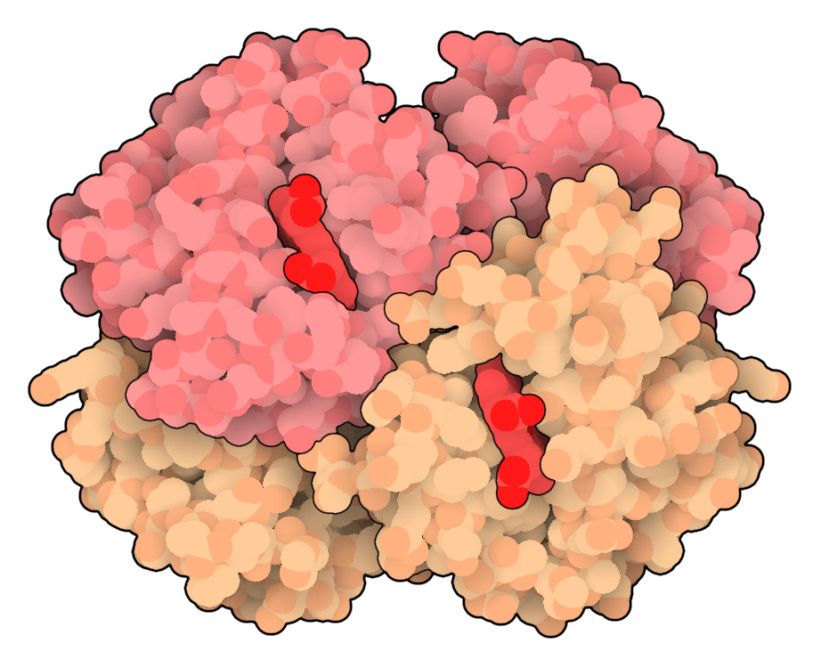
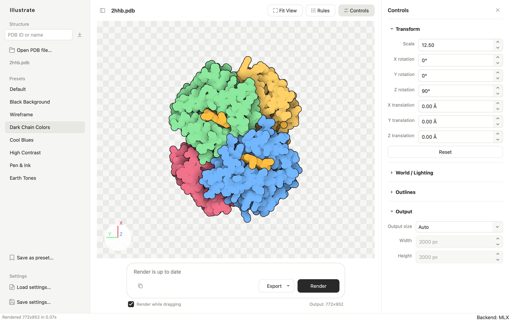

<p align="center">
  
</p>

# Illustrate

Illustrate turns PDB structures into molecular illustrations. It draws atoms as shaded spheres and uses ordered rules to assign colors and radii. This Python implementation of David Goodsell’s renderer includes a macOS desktop app, a CLI, and a Python API.

## Install on macOS

Install in an environment with Python 3.10 or newer.

```bash
python -m pip install "illustrate-py[gui]"
```

The `gui` extra installs PySide6. Omit it for the CLI and Python API.

## Make a figure

### Desktop

```bash
illustrate-gui
```

Open a local PDB file or enter a PDB ID and select **Fetch**. Pick a preset, drag to rotate, and use **Rules** to change which atoms are colored or hidden. **Export** saves the last full render.

<p align="center">
  
</p>

### Command line

```bash
illustrate-py 2hhb --preset "Cool Blues" --width 640 -o hemoglobin.png
```

Use a path in place of the PDB ID to render a local file. Run `illustrate-py --help` for batch output, image sizing, and settings saved from the GUI.

### Python

```python
from illustrate import export_png, fetch_pdb, render, render_params_from_preset

path = fetch_pdb("2hhb")
params = render_params_from_preset("Cool Blues", str(path))
result = render(params)
export_png("hemoglobin.png", result.rgb, result.opacity)
```

The renderer reads fixed-column PDB files and produces images up to 3000 × 3000 pixels. SVG export embeds the rendered PNG. Automatic selection prefers MLX on Apple Silicon and uses Numba for compiled CPU rendering when available, with NumPy as the portable CPU backend. Use `--backend numba` on the CLI or `backend="numba"` in Python to select compiled CPU rendering explicitly.

## Guides

- [Getting started](https://github.com/Alfredo-Sandoval/Illustrate/blob/main/docs/getting-started.md) covers installation from a checkout and a first render with the bundled example.
- [Desktop GUI](https://github.com/Alfredo-Sandoval/Illustrate/blob/main/docs/guide/gui.md) covers the viewport, settings, and export.
- [Presets](https://github.com/Alfredo-Sandoval/Illustrate/blob/main/docs/guide/presets.md) and [selection rules](https://github.com/Alfredo-Sandoval/Illustrate/blob/main/docs/guide/selection-rules.md) cover styling.
- [Python and CLI reference](https://github.com/Alfredo-Sandoval/Illustrate/blob/main/docs/reference.md) and [troubleshooting](https://github.com/Alfredo-Sandoval/Illustrate/blob/main/docs/troubleshooting.md) cover scripting and common errors.

## Attribution and license

David S. Goodsell wrote the original Illustrate renderer. The 2019 Fortran source is in [archive/illustrate.f](https://github.com/Alfredo-Sandoval/Illustrate/blob/main/archive/illustrate.f). See Goodsell and Olson, “Molecular Illustration in Black and White,” *Journal of Molecular Graphics* 10 (1992), 235–240.

The Python implementation is by Alfredo Sandoval. Illustrate is licensed under [Apache 2.0](https://github.com/Alfredo-Sandoval/Illustrate/blob/main/LICENSE).
