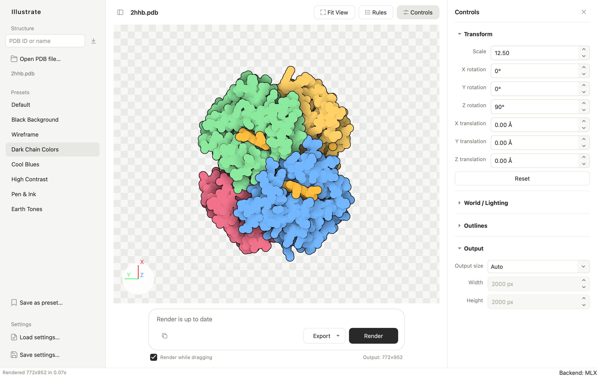

# Desktop GUI

Launch `illustrate-gui` after installation. Use **Open PDB** for a local file. To fetch a structure, enter a four-character PDB ID or search by name and choose a suggestion. The app fits a newly opened or fetched structure to the viewport. A settings file restores its saved scale. [Installation](../getting-started.md)

## Orient and size the figure

- Drag to rotate. With **Render while dragging** enabled, dragging and edits to **Transform** schedule new renders. For other settings changes, click **Render** when it turns amber.
- Scroll to magnify the displayed image up to 8×. Shift-drag or middle-drag pans the magnified image. To change the render itself, adjust **Scale** or use **Fit View**.
- In **Controls**, choose **Auto** output size to frame the structure or **Custom** to specify width and height in pixels. The renderer rounds dimensions down to even numbers and caps them at 3000.

## Change colors and outlines

Choose a preset in the sidebar. With a structure loaded, switching presets keeps the current view within the new preset’s scale limit.

Open **Rules** to edit [selection rules](selection-rules.md). Move specific rules above broader ones with **Up** and **Down**. Double-click a color or value to edit it. **Matches** counts retained atoms assigned to each rule during classification. Rules with zero radius hide their atoms and show zero retained matches.

Use **World / Lighting** for background, fog, and shadows, and **Outlines** for contour and boundary settings.

## Save and export

- **Save Settings** writes JSON with the structure path and current controls. Load it later in the app or pass it to `illustrate-py --settings`. Keep the original PDB available.
- **Save as preset…** adds the current look to the preset list for reuse with other structures.
- **Export PNG**, **Export SVG**, and **Copy to Clipboard** use the last full render. After changing the look, render before exporting. SVG embeds the rendered PNG.

The three rotation controls apply X, then Y, then Z. The app converts saved rotation lists to those axes. Use the Python API for centering modes other than `auto` and for numeric settings outside the GUI controls’ ranges.
