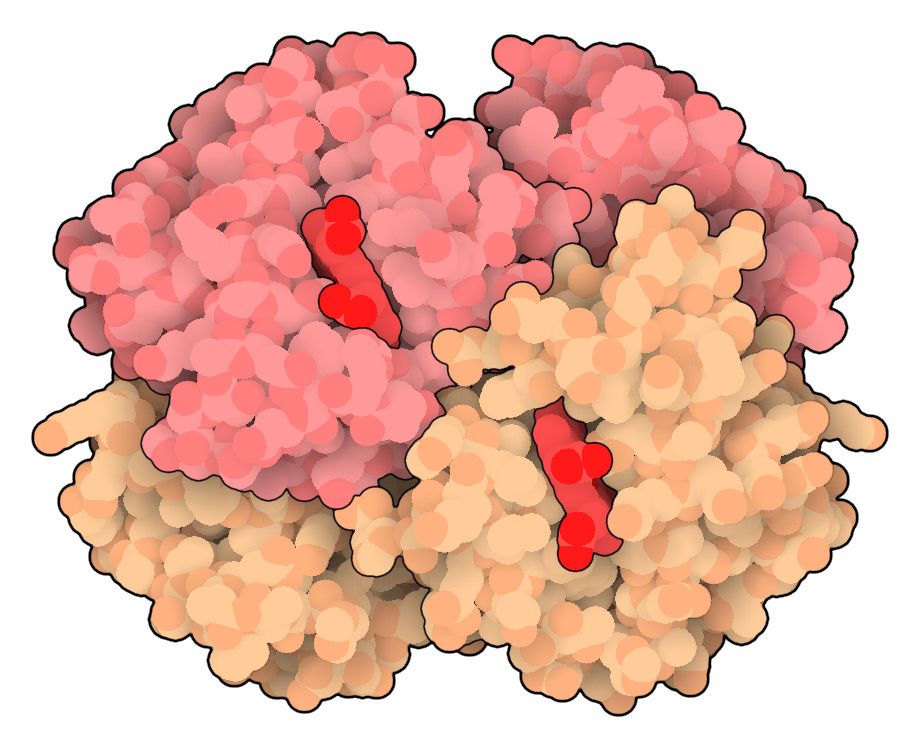
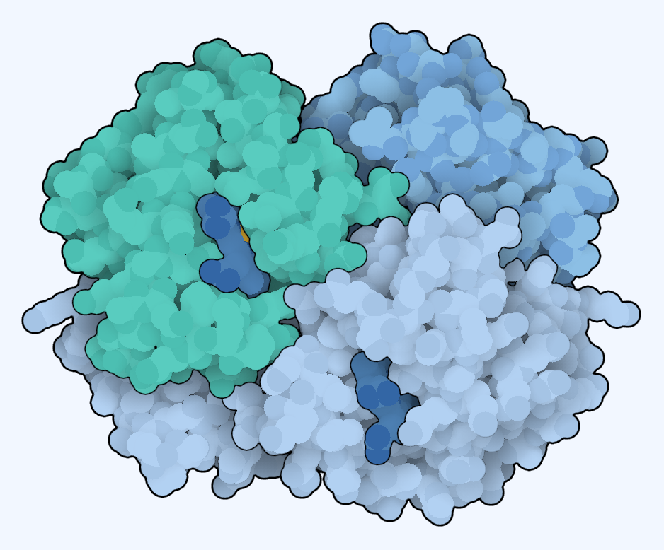
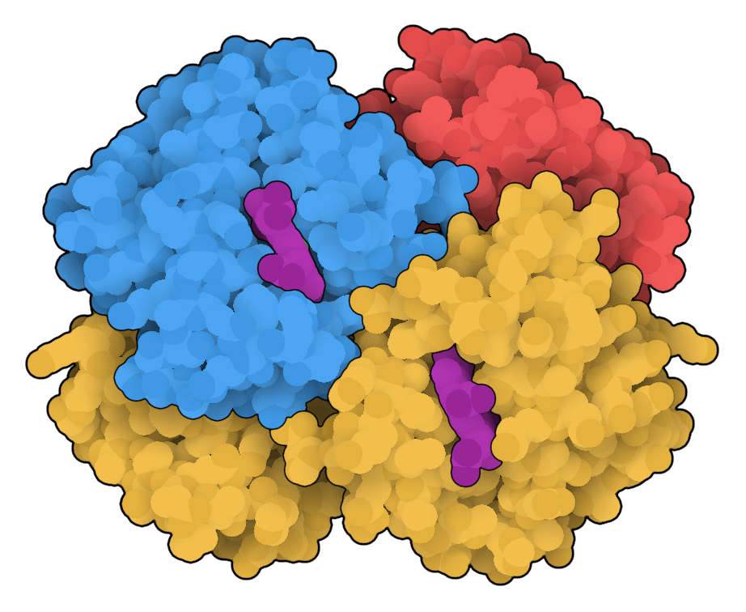
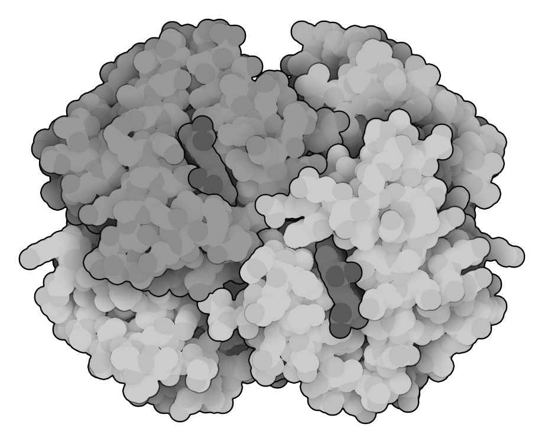
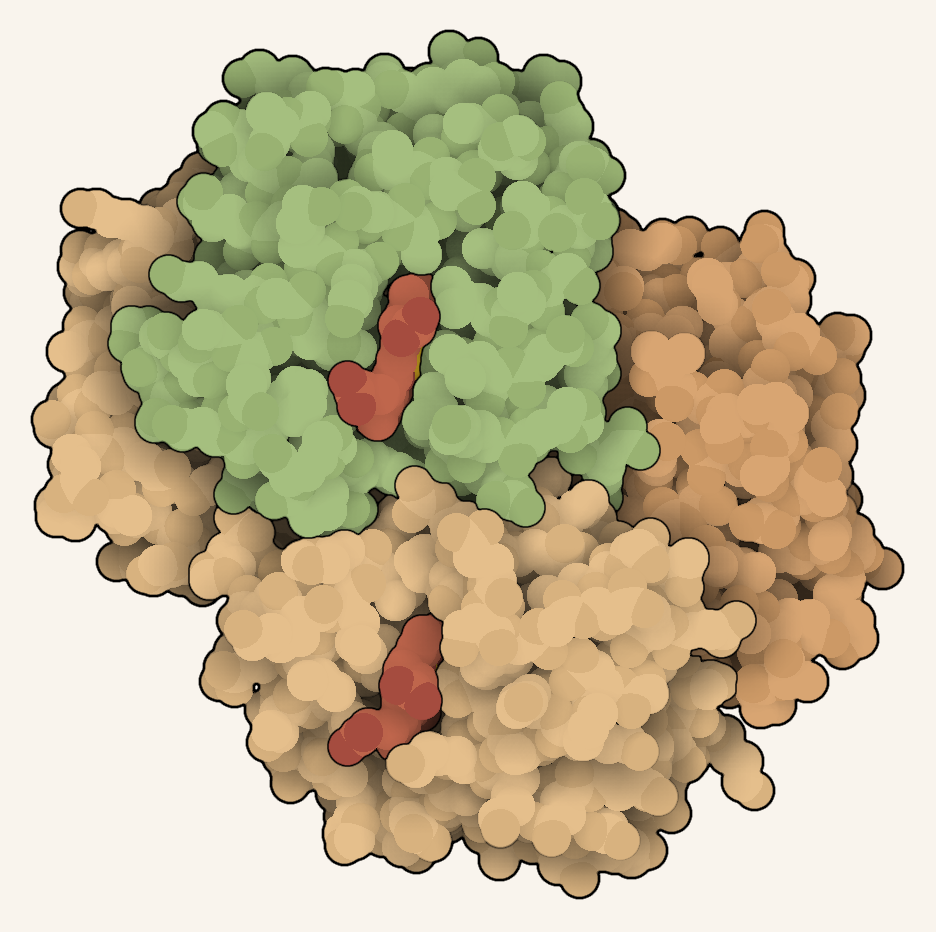

---
hide:
  - navigation
  - toc
---

  

    <h1>Illustrate</h1>
    
Render PDB structures as shaded spheres with the desktop app, CLI, or Python.

    

      <a href="getting-started/" class="button primary">Get Started</a>
      <a href="https://github.com/Alfredo-Sandoval/Illustrate" class="button secondary">GitHub</a>
    

  

  

    
    
Hemoglobin (PDB 2HHB)

  

  

    
    Cool Blues
  

  

    
    High Contrast
  

  

    
    Pen &amp; Ink
  

  

    
    Earth Tones
  

  <a href="guide/presets/">Using presets &rarr;</a>

